# finanzas-personales-banco-nu

Convierte los extractos en PDF de **Nu Colombia** (cuenta de ahorros y tarjeta de crédito) en movimientos
clasificados dentro de un libro de Excel, y los analiza en un informe de **Power BI**.

```
PDF Nu ──► finanzas_nu (Python) ──► Libro de Excel ──► Power BI (bi/Finanzas Nu.pbix)
```

> **Datos de ejemplo.** Todo lo que trae el repositorio es inventado: el libro `datos_demo/LIBRO FINANCIERO DEMO.xlsx`
> y los datos guardados en `bi/Finanzas Nu.pbix` (personas, comercios, montos y fechas).

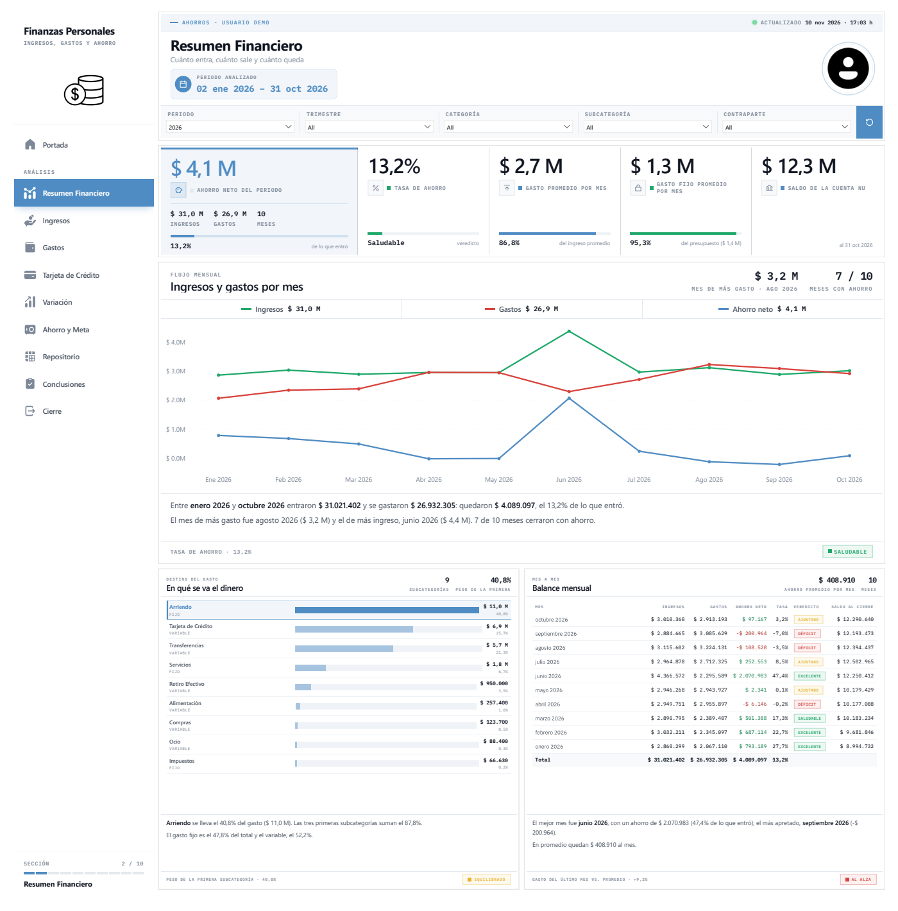

### Del PDF al Excel

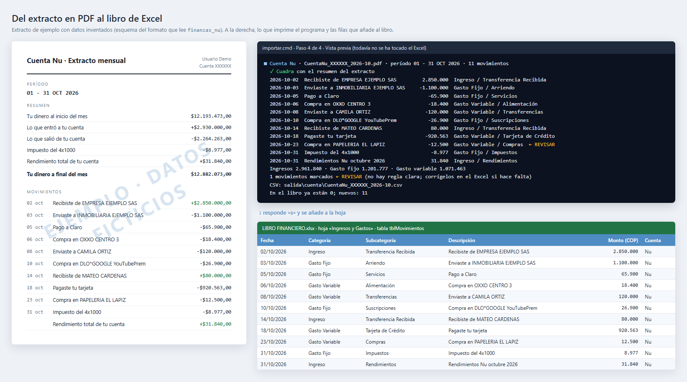

El extracto de la imagen es un **esquema con datos inventados** (no es un PDF real de Nu). La consola y las filas
del libro sí son lo que el programa imprime y escribe al leer esos movimientos: cada uno sale clasificado, el
total cuadra con el resumen del extracto y lo que no tiene regla clara queda marcado `← REVISAR`.

| Extracto | Hoja del libro | Tabla |
|---|---|---|
| Cuenta Nu (ahorros), `CuentaNu_XXXXXX_AAAA-MM.pdf` | Ingresos y Gastos | `tblMovimientos` |
| Tarjeta de Crédito Nu, `Nu_AAAA-MM-DD.pdf` | Tarjeta de Crédito (se crea sola la primera vez) | `tblTarjeta` |

El programa reconoce solo de qué tipo es cada PDF y deja también un CSV por extracto.

## Uso fácil: doble clic en `importar.cmd`

1. Cierra el libro de Excel.
2. Doble clic en `importar.cmd`. Se abre una ventana negra y otra para elegir archivos.
3. Elige uno o varios PDF (con Ctrl marcas varios; pueden mezclarse de cuenta y de tarjeta).
4. Si el PDF tiene contraseña, te la pide (no se ve al escribirla) y te ofrece recordarla en `.env`.
5. Revisa la lista: debe decir **✓ Cuadra con el resumen del extracto**. Las filas con `← REVISAR`
   no tenían una regla clara; puedes corregirlas en el Excel y el mes siguiente salen igual.
6. Responde `s` para añadirlos al libro y Enter para cerrar.

Todo lo que se ve en la ventana queda en `registros\registro_importaciones.txt` (con fecha y hora,
y las respuestas que diste). La contraseña nunca se escribe.

## Carpetas

```
finanzas-personales-banco-nu/
├─ importar.cmd            doble clic = modo guiado
├─ LICENSE                 licencia MIT
├─ finanzas_nu/            el programa
│  ├─ comun/               lo que comparten los dos extractos
│  │  ├─ pdf.py              abrir el PDF (con o sin contraseña), líneas, montos, tipo de extracto
│  │  ├─ clasificar.py       reglas + historial
│  │  ├─ libro_excel.py      leer / añadir / crear tablas en el .xlsx sin tocar lo demás
│  │  ├─ proceso.py          leer → cuadrar → clasificar → CSV → libro
│  │  └─ registro.py         registro .txt de cada ejecución
│  ├─ cuenta/              extracto de la Cuenta Nu
│  ├─ tarjeta/             extracto de la Tarjeta de Crédito Nu
│  ├─ asistente.py         el modo guiado
│  └─ __main__.py          línea de comandos
├─ config/
│  ├─ reglas_cuenta.json   categorías de la cuenta
│  └─ reglas_tarjeta.json  categorías de la tarjeta
├─ bi/
│  ├─ Finanzas Nu.pbix       informe de Power BI (con los datos de ejemplo)
│  └─ preparar_libro.py      crea en tu libro las hojas Proyectos, Supuestos y Metas
├─ datos_demo/
│  └─ LIBRO FINANCIERO DEMO.xlsx   libro inventado con la misma forma que el real
├─ docs/img/                   capturas del informe y del flujo PDF → Excel (datos de ejemplo)
├─ extractos/cuenta|tarjeta/   copia de cada PDF ya importado (no se sube)
├─ salida/cuenta|tarjeta/      un CSV por extracto (no se sube)
├─ respaldos/                  copia del libro antes de cada escritura (no se sube)
├─ registros/                  registro_importaciones.txt (no se sube)
└─ tests/
```

## Hoja 'Tarjeta de Crédito'

Una fila por **línea del extracto**. Una compra a 24 cuotas aparece en 24 extractos (1 de 24, 2 de 24…),
una vez en cada uno, con lo que se cobró ese mes.

| Columna | Qué es |
|---|---|
| Tipo | Compra, Pago, Devolución, Ajuste a favor, Beneficio, Avance |
| Valor (COP) | valor original de la operación |
| Cuota / Total Cuotas | 2 y 24 en "2 de 24" |
| Valor del Mes | capital que se cobra en este extracto |
| Tasa M.V. / Intereses | interés del mes |
| Comisiones | comisión por cambio de moneda (compras en el exterior) |
| Total a Pagar / Restante | lo que se cobra este mes y lo que queda pendiente |
| Nueva en el Extracto | **Sí** si la compra aparece por primera vez (cuota 1 y con capital cobrado) |
| Fecha de Corte | identifica el extracto |

- **Lo que compraste en un mes**: Tipo = Compra y Nueva en el Extracto = Sí → suma de *Valor*.
- **Lo que te cobraron**: suma de *Total a Pagar* + *Comisiones* por Fecha de Corte (= pago mínimo del extracto).
- El pago de la tarjeta aparece dos veces a propósito: en la cuenta ("Pagaste tu tarjeta", gasto) y en
  la tarjeta (Tipo = Pago). En Power BI el gasto es el de la cuenta (con el pago); las compras de la tarjeta
  sólo se analizan en su página.

Cada extracto se cuadra contra su resumen: deuda del mes, intereses, cargos por conversión, abonos,
devoluciones y pago mínimo.

## Clasificación

En este orden (`config/reglas_*.json`):

1. **Reglas específicas**: comercios y pagos concretos.
2. **Historial del libro**: si esa descripción ya se clasificó antes en esa hoja, se repite la categoría más usada.
3. **Reglas genéricas**.
4. Lo que no case con nada sale marcado `← REVISAR`.

Las reglas son expresiones regulares: añade las de tus comercios habituales.

## Informe de Power BI (`bi/Finanzas Nu.pbix`)

Banner con filtros (Periodo, Trimestre, Categoría, Subcategoría, Contraparte), rail vertical de navegación,
tarjetas KPI, gráficos HTML y gráficos de línea nativos, cada uno con un texto de lectura de 150 px.

**Abrirlo:** doble clic en `bi\Finanzas Nu.pbix` (Power BI Desktop). Trae cargados los datos de ejemplo.

**Con tus datos:**

1. Prepara tu libro con `importar.cmd` y, la primera vez, `.venv\Scripts\python.exe bi\preparar_libro.py`
   (crea las hojas Proyectos, Supuestos y Metas).
2. En Power BI: **Transformar datos > Editar parámetros > RutaLibro** = ruta completa de tu libro.
3. **Inicio > Actualizar**.

| Página | Qué responde |
|---|---|
| Portada | identidad del informe y periodo |
| Resumen Financiero | cuánto entra, cuánto sale y cuánto queda; en qué se va el dinero; balance mes a mes |
| Ingresos | ingresos por mes frente al salario neto; fuentes; del salario bruto al disponible |
| Gastos | fijo vs variable frente al presupuesto; destinos; gastos más grandes; subcategoría por mes |
| Tarjeta de Crédito | compras, cobros y pagos por extracto; subcategorías; compras a cuotas |
| Variación | último mes frente al anterior y trimestre frente al anterior: ingresos, gastos, ahorro y qué subcategorías explican el cambio |
| Ahorro y Meta | avance de la meta, ahorro requerido, simulador (control deslizante) y proyección |
| Repositorio | los 300 movimientos más recientes del filtro |
| Conclusiones | conclusión general y semáforo de 7 indicadores |
| Cierre | resumen final |

### Vista previa de las páginas

Capturas del `.pbix` del repositorio, con los datos de ejemplo (clic para verlas en grande).

<table>
<tr>
<td width="50%"><a href="docs/img/pagina-01-portada.png"></a><br><sub><b>Portada</b></sub></td>
<td width="50%"><a href="docs/img/pagina-02-resumen-financiero.png"></a><br><sub><b>Resumen Financiero</b></sub></td>
</tr>
<tr>
<td><a href="docs/img/pagina-03-ingresos.png">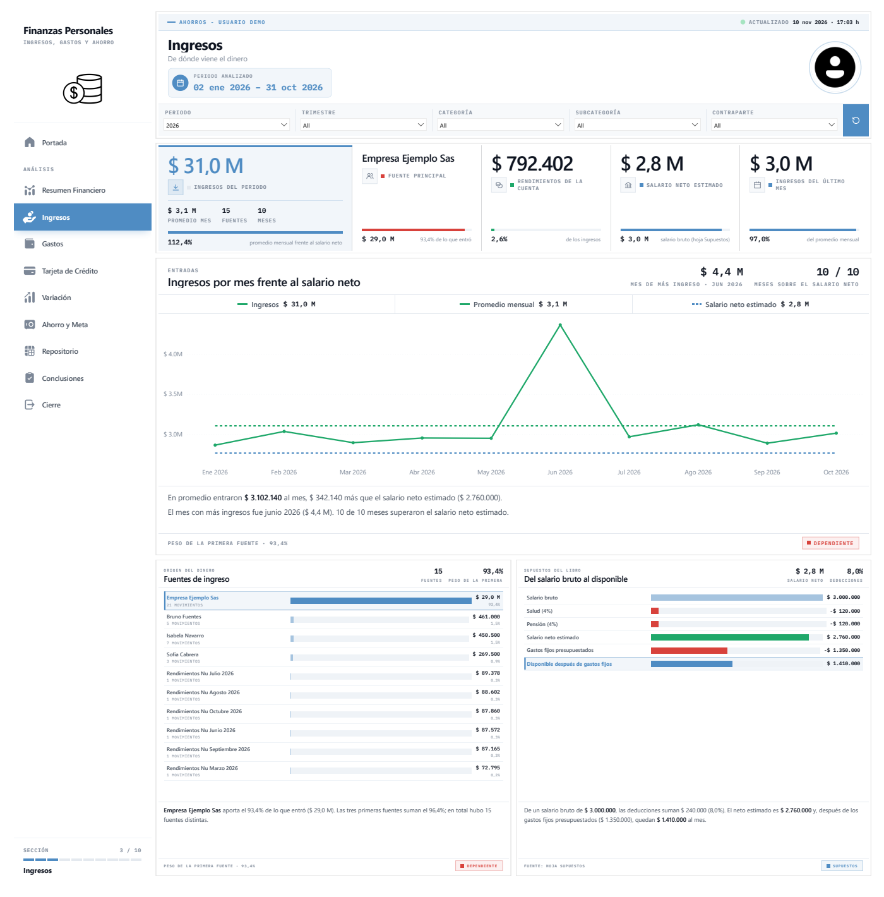</a><br><sub><b>Ingresos</b></sub></td>
<td><a href="docs/img/pagina-04-gastos.png">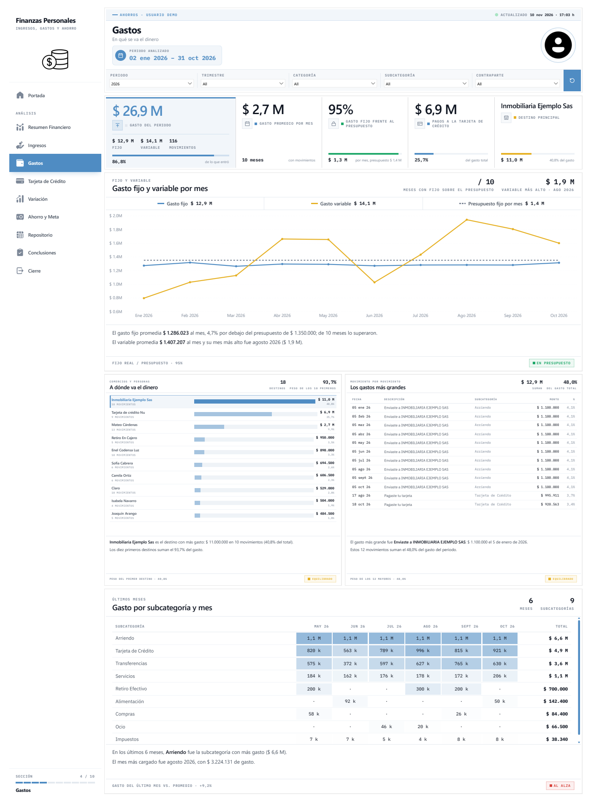</a><br><sub><b>Gastos</b></sub></td>
</tr>
<tr>
<td><a href="docs/img/pagina-05-tarjeta-de-credito.png">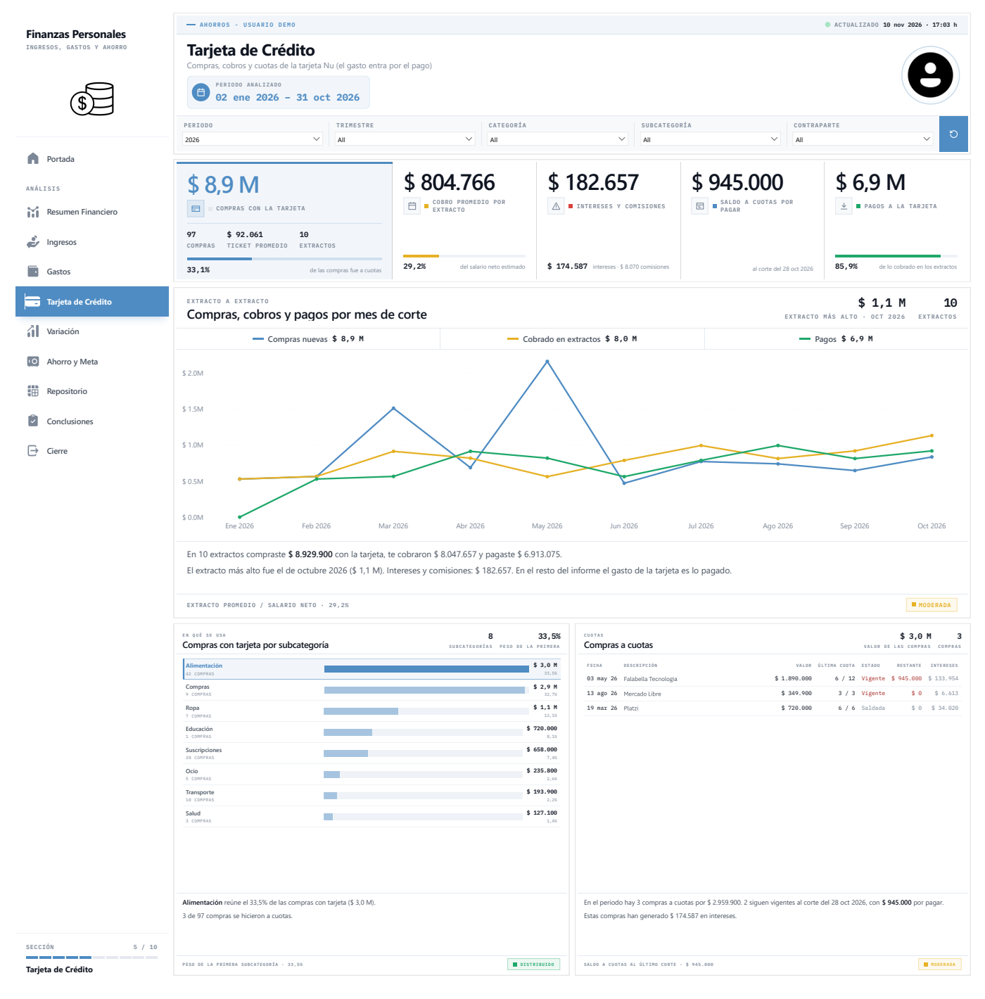</a><br><sub><b>Tarjeta de Crédito</b></sub></td>
<td><a href="docs/img/pagina-06-variacion.png">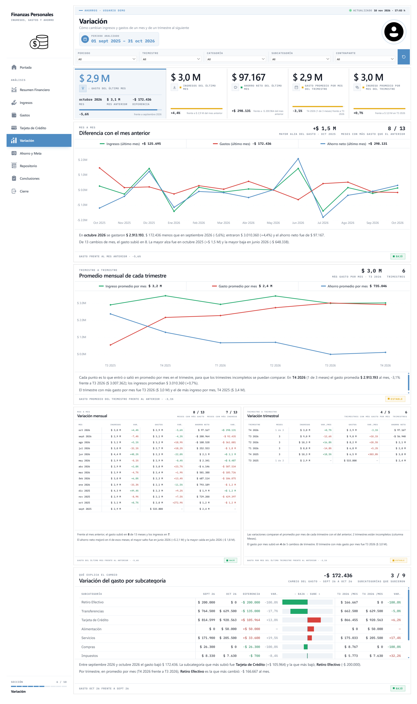</a><br><sub><b>Variación</b></sub></td>
</tr>
<tr>
<td><a href="docs/img/pagina-07-ahorro-y-meta.png">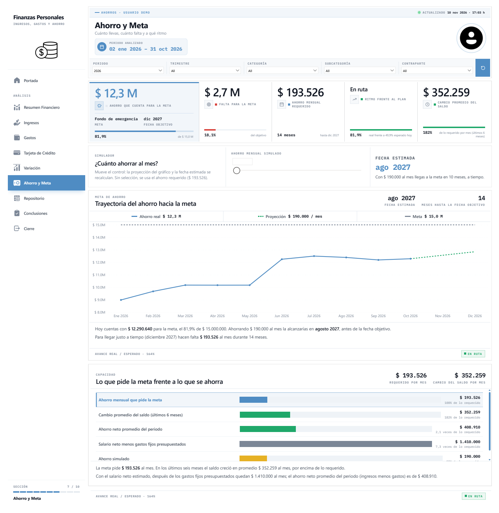</a><br><sub><b>Ahorro y Meta</b></sub></td>
<td><a href="docs/img/pagina-08-repositorio.png">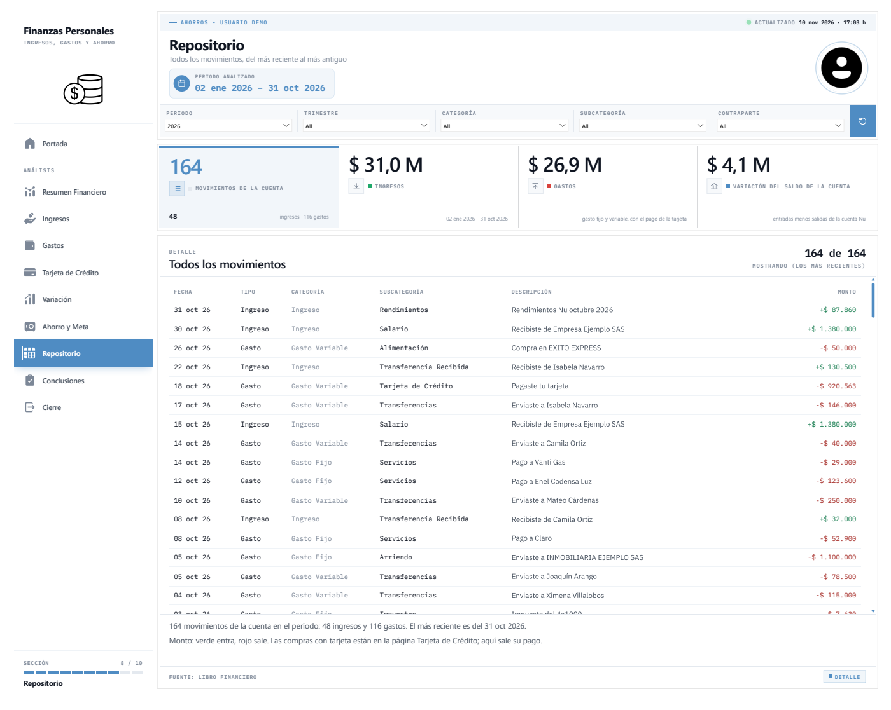</a><br><sub><b>Repositorio</b></sub></td>
</tr>
<tr>
<td><a href="docs/img/pagina-09-conclusiones.png">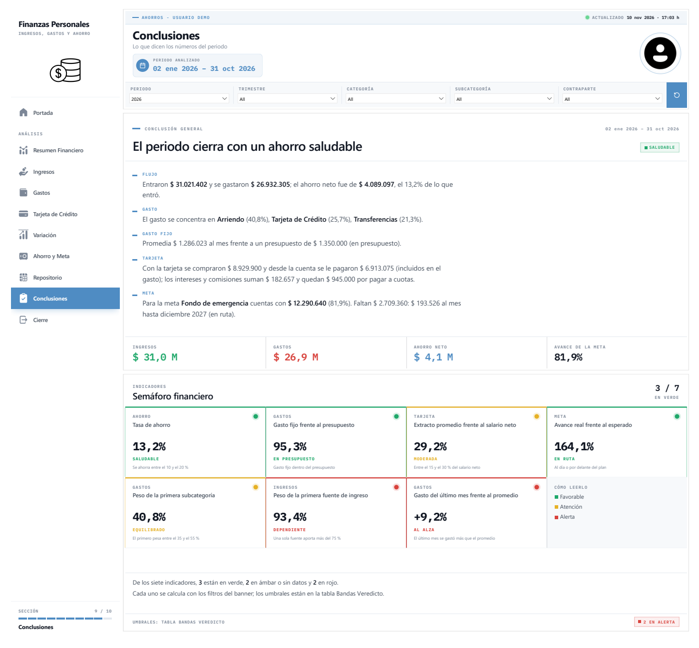</a><br><sub><b>Conclusiones</b></sub></td>
<td><a href="docs/img/pagina-10-cierre.png"></a><br><sub><b>Cierre</b></sub></td>
</tr>
</table>

### Algunos gráficos

**Ingresos y gastos por mes** (Resumen Financiero): líneas nativas de Power BI con el total del periodo en la leyenda
y, debajo, el texto de lectura que se escribe solo con los filtros.

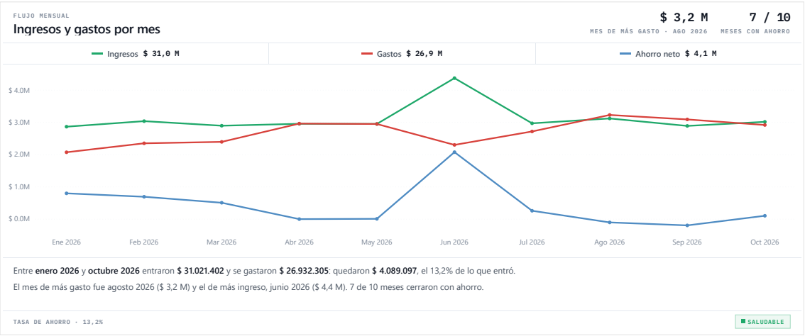

**Compras, cobros y pagos por mes de corte** (Tarjeta de Crédito): lo que compraste, lo que te cobraron y lo que pagaste en cada extracto.

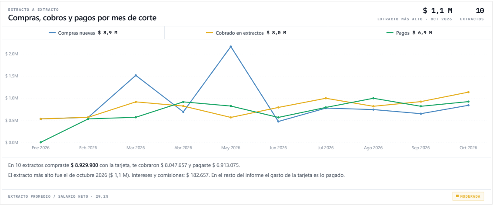

**Promedio mensual de cada trimestre** (Variación): los trimestres incompletos se comparan por su promedio por mes.

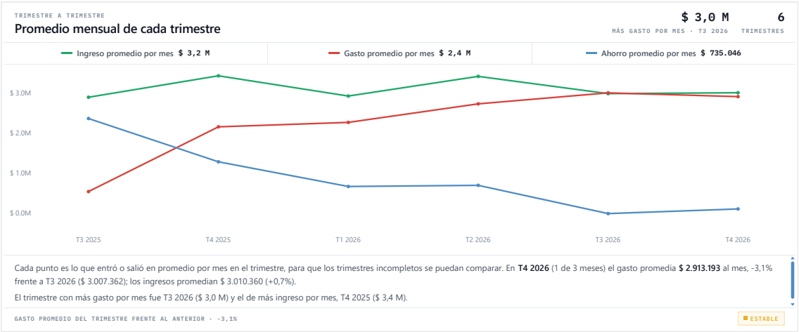

**Variación del gasto por subcategoría** (Variación): qué subcategorías explican el cambio del último mes, con barras divergentes.

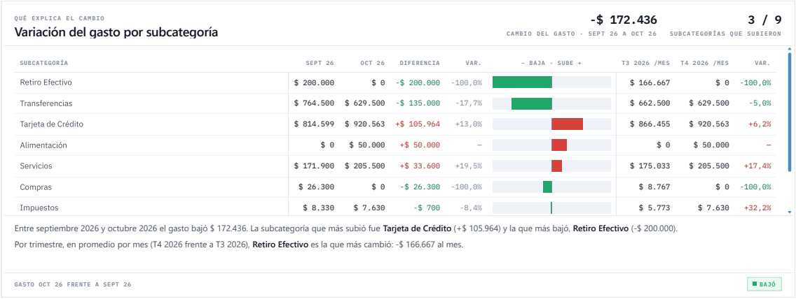

### Lo que se cambia desde el Excel (sin abrir Power BI)

| Hoja | Para qué |
|---|---|
| **Proyectos** (`tblProyectos`) | identidad: id (`001`), nombre, color, símbolo, logo del proyecto, logo de la marca, titular. El informe carga la fila del parámetro `pIdProyecto`. |
| **Supuestos** (`tblSupuestos`) | salario bruto, salud, pensión, FSP, retención, auxilio de transporte, gastos fijos presupuestados, rentabilidad para proyectar, saldo inicial y ajuste de la meta. Los `%` se escriben como `4` = 4 %. |
| **Metas** (`tblMetas`) | meta de ahorro: monto, fecha de inicio, fecha objetivo y si está activa. |

### Lo que se cambia dentro del modelo

| Tabla | Para qué |
|---|---|
| `Bandas Veredicto` | umbrales, etiquetas y colores de los veredictos (Déficit / Ajustado / Saludable / Excelente…). Nunca en los gráficos. |
| `ConfiguracionFiltros` | rótulos de la fila de filtros del banner. |
| `Nav_Paginas` | páginas del rail: nombre, subtítulo e icono. Cada página filtra esta tabla por su `Codigo`. |

### Cómo se limpian los datos (Power Query)

- **Movimientos** es la hoja *Ingresos y Gastos* tal cual la clasifica el libro, con `Ingreso`, `Gasto` y `Flujo`
  ya con signo: `Ingreso` = categoría *Ingreso*; `Gasto` = *Gasto Fijo* + *Gasto Variable*. Las cifras del informe
  son las mismas que las del Excel, e ingresos − gastos = cambio del saldo de la cuenta.
- El **pago de la tarjeta** ("Pagaste tu tarjeta") es gasto, como en el Excel. Las compras con tarjeta **no** se suman
  al gasto (sería contarlas dos veces): su detalle está en la tabla **Tarjeta** y en la página Tarjeta de Crédito.
- En **Tarjeta**, el pago usa la misma categoría que en la cuenta (*Gasto Variable / Tarjeta de Crédito*) y todas
  las columnas llevan su tipo en Power Query (si una queda sin tipo, Desktop la vuelve texto al actualizar).
- Nu corta los nombres largos ("Isabela Navarro Cabre"): se unen con el nombre completo.
- **Calendario** va del primer mes con datos hasta la fecha de la meta (la proyección necesita esos meses) y trae
  `Trimestre Año` e índices de mes y trimestre para las comparaciones con el periodo anterior.
- **Variación**: el mes de referencia es el último con movimientos dentro del filtro de fechas. Los trimestres se
  comparan por su **promedio mensual**, para que uno incompleto (el último, por ejemplo) sea comparable.

## Instalación

Python 3.11 o superior.

```bash
python -m venv .venv
```

```bash
.venv\Scripts\python.exe -m pip install -r requirements.txt
```

Copia `.env.example` como `.env` y rellena `LIBRO_RUTA`.

## Uso desde la consola

`importar.cmd` con argumentos es un atajo de `.venv\Scripts\python.exe -m finanzas_nu`.

```bash
importar.cmd "C:\Users\...\Downloads\TARJETA CREDITO NU"
```

```bash
importar.cmd "C:\Users\...\Downloads\TARJETA CREDITO NU" --escribir
```

| Opción | Qué hace |
|---|---|
| (carpeta) | procesa todos los PDF de la carpeta |
| `--escribir` | añade al libro lo que falta (respaldo antes; no duplica; no escribe si el PDF no cuadra) |
| `--comparar` | compara el PDF con lo que ya hay en el libro (no escribe) |
| `--sin-tabla` | sólo el resumen de cada PDF |
| `--sin-historial` | clasifica sólo con las reglas (para probarlas) |
| `--forzar` | escribe aunque no cuadre |

Pruebas: `.venv\Scripts\python.exe -m unittest discover tests`

## Privacidad

`.gitignore` deja fuera de GitHub todo lo que lleva datos reales: `.env` (contraseña del PDF y ruta del libro),
los PDF, los libros `.xlsx` (salvo el de `datos_demo/`), los CSV, `extractos/`, `salida/`, `respaldos/` y `registros/`.
Si guardas un `.pbix` con tus propios datos, no lo subas: el archivo lleva dentro todos los movimientos.

## Licencia

[MIT](LICENSE).
